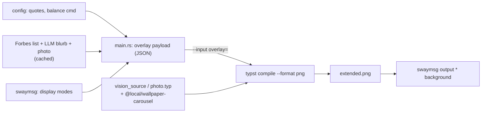

# Architecture

Renders a wallpaper: a background (the vision document, or an arbitrary photo) with a quote,
a balance readout, billionaire trivia and a year-progress bar laid over it, then hands it to sway.



## Codemap

**`src/main.rs`** — the whole of the Rust side. Gathers data (config, Forbes, safe area),
serializes it, invokes `typst`, sets the wallpaper. `compile_wallpaper` is the only place that
shells out to typst.

**`src_typ/`** — layout, shipped as the typst package `@local/wallpaper-carousel`. `overlay.typ`
decodes the payload and exports `overlay()`, `page-size` and `inset`.

**`src/photo.typ`** — embedded in the binary and fed to typst over stdin: a bare page with a photo
background and the overlay placed top-right.

The vision document is not part of the repo: `vision_source` points at a user-owned `.typ` that
imports the package and appends `overlay()` to its flow (`examples/vision.typ`).

## Invariants

- **Typst owns all layout.** Rust never positions, measures, wraps or rasterizes text. Two layout
  engines cannot agree on coordinates, which is how the overlay used to paint over the document.
- **Overlap is impossible by construction, not by bookkeeping.** On the vision path the overlay is
  flow content. If it stops fitting, typst emits a second page and the run fails loudly — there is
  no configuration in which it silently covers something.
- **One payload, one hand-off.** Everything typst needs arrives as a single `--input overlay=<json>`.
  Adding an information source is a new JSON field, never a new file or a new argument.
- **A decoration must never cost the wallpaper.** Forbes, the LLM blurb and the photo are best-effort — they
  fall back to their cache (the photo to none), and a render that used an expired one re-renders on
  exponential backoff until the network returns. Only a failure a later attempt could clear on its own buys a retry — a
  revoked key or a retired model gives up at once. Every other failure aborts the run rather than
  rendering something wrong.
- **The page is 1920pt wide, always.** Height follows the display's aspect ratio and `--ppi` scales
  the raster to its resolution, so text keeps the same relative size on every screen.
- **Everything renders inside the safe area** — the region visible on *all* active displays under
  sway's `fill` — passed to typst as the page margin. `edge_padding` (20pt) is the only breathing
  room on top of it; no layer adds margins of its own.

```
┌─ page: 1920pt × display ratio ────────────────┐
│ safe-area inset (0 when all displays agree)   │
│  ┌─ + edge_padding ────────────────────────┐  │
│  │  vision_source: own layout     overlay()│  │
│  └─────────────────────────────────────────┘  │
└───────────────────────────────────────────────┘
```
